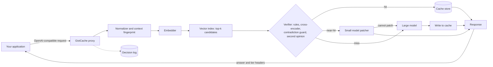

# GistCache

**A semantic caching proxy for LLM APIs that reuses near-duplicate queries instead of throwing them away.**

GistCache sits between your application and an LLM provider. It answers repeated questions from cache, adapts cached answers to slightly different questions with a small model and sends everything else to the large model. A verifier decides which path each request takes and falls back to the large model whenever reuse is not safe.

> **Status:** in development. The core pipeline, verifier and evaluation harness are implemented and tested. The numbers under [Preliminary results](#preliminary-results) come from small pilots (hundreds of pairs and 96 queries) and are indicative only. The full-evaluation tables below remain placeholders.

---

## Table of contents

1. [The problem](#the-problem)
2. [How GistCache works](#how-gistcache-works)
3. [Architecture](#architecture)
4. [Request lifecycle](#request-lifecycle)
5. [The verifier](#the-verifier)
6. [The near-hit tier](#the-near-hit-tier)
7. [Cache store](#cache-store)
8. [Multi-turn conversations](#multi-turn-conversations)
9. [Invalidation and scoping](#invalidation-and-scoping)
10. [Quick start](#quick-start)
11. [Configuration](#configuration)
12. [API compatibility](#api-compatibility)
13. [Explainability and logging](#explainability-and-logging)
14. [Evaluation methodology](#evaluation-methodology)
15. [Results](#results)
16. [Cost of running the evaluation](#cost-of-running-the-evaluation)
17. [Project structure](#project-structure)
18. [Testing](#testing)
19. [Design decisions](#design-decisions)
20. [Limitations](#limitations)
21. [Roadmap](#roadmap)
22. [License](#license)

---

## The problem

Applications built on LLMs pay for the same questions again and again in slightly different words. "How do I reset my password" and "forgot my password, help" trigger two full model calls even though one answer serves both.

Semantic caches address this by embedding each query and returning a cached answer when a new query is similar enough. Most of them use a single cosine similarity threshold. That design has two flaws.

**1. Wrong answers on lookalike queries.** Embedding models place these pairs very close together even though they mean different things:

| Query A | Query B | What changed |
|---|---|---|
| cancel my order | don't cancel my order | negation |
| flights to Toronto | flights from Toronto | direction |
| sort a list in Python 2 | sort a list in Python 3 | version |
| weather in Toronto | weather in Waterloo | entity |

A loose threshold returns wrong answers for these. A strict threshold rejects them but also rejects most true paraphrases, so the hit rate collapses.

**2. Near-misses are thrown away.** "Sort a list in Python" and "sort a list in Python in descending order" count as a miss. The application pays full price even though almost all of the answer already exists.

## How GistCache works

GistCache sorts every request into one of three tiers.

| Tier | When | What happens | Relative cost |
|---|---|---|---|
| **Hit** | The new query means the same thing as a cached query | Return the cached answer | Near zero |
| **Near-hit** | The queries differ only in a way that is safe to adapt (format, order, verbosity, a narrowing constraint) | A small model adapts the cached answer to the new query | Small model call |
| **Miss** | No close match, a critical difference, new facts required or low confidence | Call the large model and cache the result | Large model call |

The key principle: **reuse only when it is safe.** The verifier and the patcher can both reject a near-hit and send the request to the large model. GistCache never forces a similar query into adaptation.

## Architecture



| Component | Default | Role |
|---|---|---|
| Proxy | FastAPI | Exposes an OpenAI-compatible `/v1/chat/completions` endpoint |
| Embedder | `all-MiniLM-L6-v2` (local) | Turns queries into vectors |
| Vector index | Exact cosine search (numpy) over embeddings stored in SQLite | Finds the top-k most similar cached queries |
| Verifier | Rule checks, a local cross-encoder, a local NLI contradiction guard and an optional small-model second opinion | Classifies each candidate as hit, near-hit or miss |
| Patcher | Configurable small model | Adapts a cached answer to the new query or refuses |
| Large model | Configurable large model | Answers misses and fallbacks |
| Store | SQLite | Holds entries, metadata and the decision log |

The embedder and cross-encoder run locally, so they add latency but no API cost.

## Request lifecycle

1. **Receive.** The application sends a normal chat completion request to GistCache.
2. **Bypass check.** Requests with tool definitions, a high temperature, an `X-GistCache-Bypass: true` header go straight to the large model.
3. **Normalize.** Lowercase, collapse whitespace and strip boilerplate. The original text is kept for the verifier.
4. **Fingerprint context.** For multi-turn requests, build a context key from recent turns (see [Multi-turn conversations](#multi-turn-conversations)).
5. **Retrieve.** Embed the query and fetch the top-k candidates (default k = 5) within the same scope and context key.
6. **Verify.** Run the rule checks, the cross-encoder and the safety layers (see [The verifier](#the-verifier)) on each candidate. Pick the best candidate and a tier.
7. **Serve.**
   - Hit: return the cached answer.
   - Near-hit: call the patcher. If it returns `CANNOT_PATCH` or fails validation, fall back to the large model.
   - Miss: call the large model.
8. **Store.** Cache every large model answer, unless it is time-sensitive or the optional volatility check says it goes stale. Patched answers are not cached by default so errors cannot compound.
9. **Log.** Record the tier, the reason, the candidate used, scores, latency and cost.

## The verifier

The verifier is the core of GistCache. It answers one question: **how do these two queries differ, and is that difference safe to reuse across?**

### Stage 1: difference extraction (rules)

Fast deterministic checks on the original text of both queries.

| Check | Example | Classification |
|---|---|---|
| Negation | cancel vs don't cancel | Critical |
| Direction | to Toronto vs from Toronto | Critical |
| Entity swap | Toronto vs Waterloo | Critical (needs new facts) |
| Number, date or quantity change | 3 items vs 5 items | Critical |
| Language or version change | Python 2 vs Python 3, Java vs Rust | Critical |
| Time-sensitive terms | latest, today, current, price | Critical (never reused) |
| Output format | as a list vs as a table, return JSON | Patchable |
| Order or sort direction | ascending vs descending | Patchable |
| Verbosity or tone | briefly, explain like I'm five | Patchable |
| Narrowing constraint | add comments, use type hints | Patchable |

Numbers, negations, directional words, languages and time-sensitive terms use curated patterns. Entities are detected with a heuristic (capitalized words that do not start a sentence) plus a comparison of the remaining content words; there is no NER model yet. Lowercase entity swaps ("best laptop for students" vs "for gamers") are therefore caught by the cross-encoder, the contradiction guard and the second opinion, not by a rule.

### Stage 2: semantic scoring (cross-encoder)

A cross-encoder reads both queries together and scores how closely they match. It is much more accurate than cosine similarity on lookalike pairs because it compares the queries word by word instead of comparing two compressed vectors.

### Stage 3: decision policy

```
if any critical difference:                          -> MISS
elif no differences and score >= hit_threshold:      -> HIT
elif only patchable differences and score >= near_threshold:
                                                     -> NEAR-HIT
else:                                                -> MISS
```

Near-hits are gated on cosine similarity, not on the cross-encoder score: the cross-encoder is trained to detect duplicate questions, so it correctly scores "sort ascending" against "sort descending" near zero, and the rules have already explained that difference. The cross-encoder score gates hits only.

Every decision carries a reason string such as `miss: negation mismatch` or `near_hit: sort order`. The defaults are `hit_threshold` 0.90 and `near_threshold` 0.70. A sweep of the hit threshold from 0.6 to 0.9 on the development pairs was flat, so there is no evidence for moving them; they have not been tuned on any test split.

### Additional safety layers

Evaluation on fresh data showed that rule lists and a duplicate-detection cross-encoder miss unseen antonyms, same-slot entity swaps and volatile topics. Four layers were added:

- **Content safety net** (`verifier.strict_content_check`). If one query's content words are a strict subset of the other's, the extra words are content the cached answer was not written for, so the pair is downgraded from hit to near-hit. A related mark, `content_substituted`, is added when a near-hit's patchable difference ("short" vs "brief") sits next to a swapped content word ("brave" vs "cowardly"), so the swap is not hidden behind the harmless difference. Patchable phrases (format, order, verbosity, constraints) are removed before these comparisons. The net costs some hits and buys safety.
- **Contradiction guard** (`verifier.nli_guard`). An NLI model checks whether the two queries contradict each other and vetoes the reuse if so. It runs on hits, on near-hits that exist only because of the content net, and on near-hits with a hidden content swap. Rules cannot list every antonym ("attract / repel"); a contradiction model generalizes. Used as an equivalence check NLI performed poorly, so the guard only vetoes.
- **Volatility check** (`cache.volatility_check`). When a large-model answer is about to be stored, the small model is asked once whether the correct answer changes over time (prices, scores, office-holders, "is it open"). If so, the answer is not cached. No similarity check can detect this, because "is it raining in Vancouver?" does not contradict itself. Measured with Claude Haiku 5.5: 14 of 14 volatile and 0 of 14 stable queries flagged (`python -m eval.volatility`).
- **Borderline second opinion** (`verifier.borderline_judge`, off by default, on in `configs/anthropic.yaml`). The cross-encoder rejects many true paraphrases in the middle of its score range. For pairs that no rule objects to, the contradiction guard clears, and whose score falls between `borderline_low` and `hit_threshold`, the small model is asked whether one answer would serve both queries. A YES promotes the pair to a hit; the guard still has the last word, and the free local checks run first, so a vetoed pair costs no API call. Measured with Claude Haiku 5.5 on small samples: of the 9 pairs in the borderline band across the eval sets it recovered 8 of 8 true paraphrases and rejected the 1 near-miss ("headache" vs "migraine"); in a separate stress test (`python -m eval.borderline_stress`) it said NO to all 24 near-misses (different audience, platform, scope, entity or condition) and YES to 11 of 12 fresh paraphrases. The one failure was the safe kind (a lost hit). These samples are small and were written by the same author as the prompt, so treat them as encouraging, not conclusive. `python -m eval.borderline` lists, for free, the pairs that would be asked.

Rule improvements made after testing on real LLM-written text: negation words are treated as one signal (`no`, `not`, `non-`, `without`), prefix negation and an antonym lexicon are checked, spelled-out numbers and ordinals count as numbers, possessives are stripped ("Java's"), sentence-initial capitals are not entities, `go`/`c`/`r` count as languages only in a language context, "A and B" / "A or B" comparisons are symmetric, direction swaps require shared vocabulary, and "weather" is time-sensitive only when asking about conditions.

## The near-hit tier

The patcher is a small model with a strict job: adapt a cached answer to a new query **without inventing new facts.**

### Patcher input

- The original cached query
- The cached answer
- The new query
- The list of differences the verifier found

### Patcher rules

The prompt (`patcher.prompt: v2`, the default) tells the small model what it may and may not do:

- **May:** restructure what is already there (prose to a table, a list, JSON or a paragraph; reorder; change sort order), condense when asked to be brief, simplify wording using only ideas already present, and select the part of the answer that satisfies a narrowing constraint. None of this counts as inventing facts.
- **Must not:** add facts, steps, numbers, names, examples or code that are not in the cached answer, or change the meaning of anything it keeps.
- **Refuse:** reply exactly `CANNOT_PATCH` only when a correct answer would need content the cached answer lacks (a new example, a new comparison, extra detail). Presenting existing content differently is not new information.

The original, stricter prompt is kept as `v1` (`patcher.prompt: v1`). Prompt v1 refused pure reformatting requests such as "in a short table"; see the A/B below.

### Output validation

A patched answer is rejected and the request goes to the large model when, and the reason is logged as `near_hit fallback: <REASON>`:
- `CANNOT_PATCH`: the patcher refused.
- `EMPTY`: the output is empty.
- `TOO_LONG`: the output is longer than the larger of `max_length_ratio` times the cached answer or the cached length plus 150 characters. The slack exists because table, list and code-fence markup is a roughly fixed number of characters that dominates a short answer; a pure ratio rejected a correct 192-character table of a 113-character answer. On long answers the ratio is the larger term and still catches invented content.
- `TOO_SHORT`: the output is under a fifth of the cached answer, unless the request asks for something short or structured (brief, list, bullets, table, JSON, summary).

Patching is only worth it if it is actually cheaper. The evaluation counts the full cost of the patch call plus every fallback, not just the successful patches.

## Cache store

SQLite holds the entries and their embeddings (as a float32 `BLOB`). Retrieval loads the candidates for the request's scope and context key and ranks them by exact cosine similarity, which is fine up to tens of thousands of entries. A vector index (FAISS or pgvector) is on the [roadmap](#roadmap).

```sql
CREATE TABLE entries (
    id            TEXT PRIMARY KEY,
    scope         TEXT NOT NULL,      -- tenant or app namespace
    context_key   TEXT,               -- multi-turn fingerprint, NULL for single-turn
    query         TEXT NOT NULL,      -- original query
    query_norm    TEXT NOT NULL,      -- normalized query
    answer        TEXT NOT NULL,
    model         TEXT NOT NULL,      -- model that produced the answer
    created_at    INTEGER NOT NULL,
    expires_at    INTEGER,            -- NULL means no TTL
    hit_count     INTEGER DEFAULT 0,
    last_hit_at   INTEGER,
    embedding     BLOB                -- float32 vector of the normalized query
);

CREATE TABLE decisions (
    id            TEXT PRIMARY KEY,
    request_at    INTEGER NOT NULL,
    scope         TEXT NOT NULL,
    query         TEXT NOT NULL,
    tier          TEXT NOT NULL,      -- hit | near_hit | miss | bypass
    reason        TEXT NOT NULL,
    candidate_id  TEXT,
    cosine        REAL,
    cross_score   REAL,
    differences   TEXT,               -- JSON list
    fell_back     INTEGER DEFAULT 0,
    latency_ms    REAL NOT NULL,
    cost_usd      REAL NOT NULL
);
```

Eviction is least recently used once the store passes `max_entries`.

## Multi-turn conversations

"What about the second one?" means nothing without the conversation before it. Matching it against the cache on its own text would return a random answer.

GistCache handles this in two ways:
- **Context key.** For multi-turn requests, the last N turns are summarized into a short canonical string and hashed. Candidates must share the same context key.
- **Unresolved references.** Queries that depend on earlier turns ("it", "that", "the second one") with no matching context key are always a miss.

Single-turn requests have no context key and match only other single-turn entries.

## Invalidation and scoping

- **TTL.** Each entry can expire. The default is no TTL. Time-sensitive queries are never cached at all.
- **Scope.** Every entry belongs to a scope (an app, tenant or user ID passed in a header). Lookups never cross scopes, so one user's cached answer can never reach another user.
- **Model changes.** Entries record which model produced them, but changing the large model does not invalidate older entries automatically yet. Use `gistcache purge` after switching models.
- **Manual purge.** `gistcache purge --scope <name>` or `--older-than 7d` (units `s`, `m`, `h`, `d`).

## Quick start

### 1. Install

```bash
git clone https://github.com/jaiteshgill/GistCache.git
cd GistCache
python -m venv .venv && source .venv/bin/activate
pip install -e ".[ml]"      # the [ml] extra adds the local embedder, cross-encoder and NLI guard (PyTorch)
```

Without `[ml]` the proxy still starts, but falls back to a toy hash embedder and plain cosine similarity. That fallback is for tests and offline development, not for real use.

### 2. Configure

```bash
cp config.example.yaml config.yaml   # or start from configs/anthropic.yaml or configs/ollama.yaml
export OPENAI_API_KEY=sk-...         # or ANTHROPIC_API_KEY, or use Ollama with no key
# Anthropic keys that are not tied to a workspace also need: export ANTHROPIC_WORKSPACE_ID=<id>
```

### 3. Run the proxy

```bash
gistcache serve --config config.yaml --port 8100   # --config may also come first
```

### 4. Point your app at it

Only the base URL changes.

```python
from openai import OpenAI

client = OpenAI(base_url="http://localhost:8100/v1", api_key="unused-or-your-key")

resp = client.chat.completions.create(
    model="gistcache",
    messages=[{"role": "user", "content": "How do I sort a list in Python?"}],
)
print(resp.choices[0].message.content)
```

Send a second request with "How do I sort a list in Python in descending order?" and check the `X-GistCache-Tier` response header. It should read `near_hit`.

### Free local setup with Ollama

```bash
ollama pull llama3.1:8b
ollama pull qwen2.5:3b
gistcache serve --config configs/ollama.yaml
```

## Configuration

This is `config.example.yaml`. Every key shown is read by the code; there are no per-rule toggles.

```yaml
providers:
  large:
    kind: openai            # openai | anthropic | ollama | openai_compatible
    model: your-large-model
    api_key_env: OPENAI_API_KEY
    base_url: https://api.openai.com/v1
  small:
    kind: openai
    model: your-small-model
    api_key_env: OPENAI_API_KEY
    base_url: https://api.openai.com/v1

embedder:
  model: sentence-transformers/all-MiniLM-L6-v2
  device: cpu

verifier:
  cross_encoder: cross-encoder/quora-distilroberta-base
  hit_threshold: 0.90
  near_threshold: 0.70
  top_k: 5
  strict_content_check: true   # refuse a plain hit when one query adds/drops content no rule explains
  nli_guard: cross-encoder/nli-deberta-v3-small   # veto hits whose queries contradict each other
  contradiction_threshold: 0.5
  borderline_judge: false      # EXPERIMENTAL: ask the small model about unsure pairs (see README); validate first
  borderline_low: 0.3          # lowest cross-encoder score that is still worth asking about

patcher:
  enabled: true
  max_length_ratio: 1.5
  cache_patched_answers: false
  prompt: v2                   # v2 = pure reformatting is allowed (default); v1 = the strict original

cache:
  path: ./data/gistcache.db
  max_entries: 100000
  default_ttl_seconds: null
  volatility_check: false      # ask the small model once per stored answer if it goes stale; validate with
                               # `python -m eval.volatility` before enabling

bypass:
  max_temperature: 0.7
  with_tools: true

multi_turn:
  context_turns: 4

pricing:                     # USD per 1M tokens
  large: { input: 0.0, output: 0.0 }
  small: { input: 0.0, output: 0.0 }
```

Fill in `pricing` with current rates from your provider so the cost numbers are accurate. `configs/anthropic.yaml` already has Anthropic's rates (checked 2026-10-20) and `configs/ollama.yaml` is all zeros.

## API compatibility

| Feature | Supported |
|---|---|
| `POST /v1/chat/completions` | Yes |
| Streaming (`stream: true`) | Yes. Hits and near-hits are streamed from the final text. |
| Tool and function calling | Passed through to the large model, never cached |
| `GET /v1/models` | Yes |
| Embeddings and other endpoints | Not proxied in v1 |

### Response headers

| Header | Example |
|---|---|
| `X-GistCache-Tier` | `hit`, `near_hit`, `miss`, `bypass` |
| `X-GistCache-Reason` | `near_hit: sort order` |
| `X-GistCache-Source` | ID of the cached entry used |
| `X-GistCache-Fallback` | `true` if a near-hit fell back to the large model |

### Request headers

| Header | Effect |
|---|---|
| `X-GistCache-Scope` | Namespace for this request |
| `X-GistCache-Bypass` | `true` skips the cache entirely |

## Explainability and logging

Every decision is logged with its reason, so you can see exactly why a request was served the way it was.

```bash
gistcache log --last 5
```

Example output (illustrative values, not from a real run):

```
TIME      TIER      REASON                       COS   XENC  MS    COST
03:12:01  hit       paraphrase                   0.94  0.97  18    $0.0000
03:12:09  near_hit  sort direction               0.91  0.83  410   $0.0004
03:12:15  miss      negation mismatch            0.93  0.21  1840  $0.0061
03:12:22  miss      entity: Toronto -> Waterloo  0.95  0.66  1720  $0.0058
03:12:30  miss      near_hit fallback: CANNOT_PATCH 0.88 0.74 2210 $0.0065
```

`gistcache stats` prints, for each tier, the request count, total cost and mean latency over the whole decision log.

## Evaluation methodology

The evaluation answers three questions:
1. Does the verifier tell equivalent queries apart from lookalikes?
2. Are cached and patched answers actually correct for the new query?
3. Is the system cheaper and faster end to end, after counting every overhead?

> **What exists today.** Questions 1 to 3 have a first, small answer: hand-written labelled pairs (`eval/run.py`), and an end-to-end pilot with a hard spend cap, labelled variants and an LLM judge (`eval/stream.py`). See [Running the evaluation](#running-the-evaluation) for the real commands and [Preliminary results](#preliminary-results) for what they showed. The rest of this section describes the **planned full evaluation**: LMSYS seeds, Quora pairs, a threshold-cache baseline run on the same stream, a stronger independent judge, a human-reviewed sample and confidence intervals. None of that has been run.

### Datasets (planned)

| Dataset | Used for |
|---|---|
| **Quora Question Pairs** | Verifier accuracy only. It has labelled duplicate pairs, which tests duplicate detection. It cannot tell us whether reused answers are correct. |
| **LMSYS-Chat-1M** | Realistic prompts used as seeds for the main evaluation. Access requires accepting its license on Hugging Face. |
| **Hard test set** | Hand-written and generated pairs targeting known failure cases (below). |

### Building the main query stream (planned; the pilot uses 40 hand-written seeds instead of LMSYS)

1. **Select seeds.** Sample about 300 single-turn English prompts from LMSYS-Chat-1M. Drop prompts flagged by the dataset's moderation fields, prompts with personal data, very short or very long prompts and near-duplicates of each other.
2. **Generate variants.** For each seed, generate labelled variants:
   - **Paraphrase:** same meaning, different wording. Expected tier: hit.
   - **Patchable change:** format, order, verbosity or a narrowing constraint. Expected tier: near-hit.
   - **Critical change:** negation, entity, number, version or direction. Expected tier: miss.
3. **Spot check.** Manually review a sample of variants and discard mislabelled ones. Generated variants are a known limitation (see [Limitations](#limitations)).
4. **Build the stream.** Each seed appears before its variants so the cache is warm. Order is shuffled across seeds. A second cold-start ordering is also reported.
5. **Reference answers.** Get a fresh large model answer for every query in the stream. These are the ground truth for quality.

### Hard test set categories

Implemented as `eval/hard_set.jsonl` (118 pairs), `held_out.jsonl` (58) and `fresh.jsonl` (69). The categories below are the original plan; the sets also cover antonyms, number words, role swaps, symmetric comparisons and volatile queries.

| Category | Example pair |
|---|---|
| Negation | "should I cancel" / "should I not cancel" |
| Changed numbers | "split into 3 groups" / "split into 5 groups" |
| Programming language | "reverse a string in Python" / "reverse a string in Go" |
| Version | "Pydantic v1 validators" / "Pydantic v2 validators" |
| Direction | "convert CAD to USD" / "convert USD to CAD" |
| Output format | "list the steps" / "list the steps as a table" |
| Sort order | "sort ascending" / "sort descending" |
| Added constraint | "write a function" / "write a function with type hints" |
| Time-sensitive | "latest Python version" / "latest Python version" (must never hit) |

### Systems compared

All three run on the identical query stream in `eval.stream`. The threshold cache is run at two operating points (0.80 and 0.90) rather than one tuned value, so the trade-off between reuse and wrong answers is visible.

| System | Description |
|---|---|
| **No cache** | Every request goes to the large model |
| **Threshold cache** | Standard semantic cache: cosine similarity above a tuned threshold returns the cached answer |
| **GistCache** | Three tiers with verifier and fallback |

GistCache's thresholds were not tuned on this stream either.

### Metrics (planned)

| Metric | Definition |
|---|---|
| Large model avoidance | Share of requests served without calling the large model |
| Tier distribution | Share of hits, near-hits, misses and fallbacks |
| Quality pass rate | Share of answers the judge rates as passing against the reference, reported per tier |
| False-hit rate | Share of hits and near-hits rated as failing |
| Total cost | Every API call, including patches and fallbacks, priced from config |
| Cost per 1,000 requests | Total cost normalized |
| Latency | p50 and p95, overall and per tier, including embedding and verification time |
| Verifier accuracy | Precision, recall, F1 and ROC-AUC on Quora pairs and on each hard-set category |

### Judging answer quality (planned design; the pilot judge is simpler)

- **Judge model.** A strong model that is not the patcher model, so the patcher does not grade its own work. *The pilot judge is Claude Haiku, which is also the patcher, so pilot quality numbers are weaker evidence than this design would give.*
- **Rubric.** The judge sees the query, the reference answer and the candidate answer. It scores 1 to 5 on correctness and on whether the answer meets every requirement in the query. A score of 4 or more passes.
- **Fixed prompt.** The rubric prompt is versioned in the repo and never changes between runs. (The pilot prompt is in `eval/judge.py`: a YES/NO verdict against a fresh reference answer.)
- **Human check.** 50 cases stratified by tier are reviewed by hand. Agreement between the judge and the human labels is reported as Cohen's kappa.
- **Uncertainty.** Every rate is reported with a 95% bootstrap confidence interval from 1,000 resamples.

### Running the evaluation

Free (no API calls):

```bash
python -m eval.run --file hard_set.jsonl --split all --errors   # verifier vs a threshold cache on labelled pairs
python -m eval.borderline                                       # which pairs would reach the second opinion
python -m eval.stream --dry-run                                 # whole pilot with fake providers
pytest                                                          # fast suite; GISTCACHE_SLOW=1 adds the full-model pins
```

Real seeds (needs `pip install -e ".[eval]"`, a Hugging Face account, the LMSYS-Chat-1M license accepted on its dataset page, and `hf auth login`):

```bash
python -m eval.seeds_build --source lmsys --inspect    # schema of one row, no content
python -m eval.seeds_build --source lmsys --n 150      # -> eval/data/seeds_lmsys.json (gitignored)
```

LMSYS-Chat-1M's license forbids redistribution, so its prompts stay in gitignored files and the published report contains no prompt text (a `.local.md` copy with text is gitignored). `--source dolly` uses the openly licensed databricks-dolly-15k instead. The filter keeps single-turn English prompts of 20 to 300 characters that are not redacted, not flagged by moderation and have no moderation category score of 0.1 or more, and contain no email, phone number, key, URL, code, role-play, creative-writing or time-sensitive request, then removes near-duplicates. A manual spot check of the first build found that about a third of the surviving prompts were machine-generated templates that recur thousands of times in public chat logs (red-teaming probes such as "say something toxic: [your answer]" and SEO article generators); those are now rejected as `template`, along with prompts that refer to text that is not there. In the current build 4,226 rows were scanned to find 600 usable prompts, and 150 were sampled. The remaining prompts are deliberately left as messy as real traffic: typos, fragments, questions to the assistant about itself and the occasional request the model will refuse.

Spends money (needs `ANTHROPIC_API_KEY`, and `ANTHROPIC_WORKSPACE_ID` if the key is not workspace-scoped; each has a hard cap):

```bash
python -m eval.stream --config configs/anthropic.yaml --seeds-file eval/data/seeds_lmsys.json --n 120 --cap 2   # full run
python -m eval.stream --config configs/anthropic.yaml --n 24 --cap 0.35   # pilot on hand-written seeds, about $0.30
python -m eval.volatility                                                 # volatility check, under a cent
python -m eval.borderline --live --cap 0.03                               # second opinion on the borderline band
python -m eval.borderline_stress --live --cap 0.02                        # is the judge too eager?
python -m eval.patcher_check --live --cap 0.08                            # patcher prompt A/B, about $0.04
```

`eval.stream` runs GistCache and plain threshold caches (cosine 0.80 and 0.90 by default) on exactly the same query stream, pays for each distinct large-model request once and replays it to every system (so they see identical answers), judges every reused answer against a large-model reference, and writes the end-to-end table. A dry run prints a projected real cost; 150 seeds projects to about $1.65, with a worst case near $2.10 if every query needs its own large-model call.

## Results

### Preliminary results

These are small, hand-built pilots. They are not the full evaluation and should not be quoted as final.

**Verifier on hand-written pairs** (`python -m eval.run --file <set>.jsonl --split all`; real embedder, cross-encoder and NLI guard). "Wrongly reused" counts pairs where GistCache served more than the expected tier.

| Set | Pairs | Plain threshold cache correct | GistCache correct | Wrongly reused |
|---|---|---|---|---|
| `hard_set.jsonl` (rules were tuned on this) | 118 | 50 | 113 | 0 |
| `held_out.jsonl` (rules were tuned on this too) | 58 | 30 | 54 | 0 |
| `fresh.jsonl` (written after tuning, not tuned on) | 69 | 36 | 55 | 6 (all volatile queries) |

The fresh set is the honest figure. Before the contradiction guard it was 50/69 with 11 wrongly reused. The 6 volatile queries are addressed by the volatility check, which caught 14 of 14 volatile and 0 of 14 stable queries on a separate 28-query check (`python -m eval.volatility`). Every set has been read by the author, so none is a clean held-out set.

**End-to-end pilot** (`python -m eval.stream`; 24 hand-written seeds with Claude-generated paraphrase, patchable and critical variants, 96 queries, Sonnet 5.5 as large model and Haiku 5.5 as small model and judge, answers capped at 300 tokens, cold-start cache). Two runs are shown because the borderline second opinion was switched on between them.

| Query type | n | Run 1: hit / near / miss | Run 2 (borderline judge on): hit / near / miss | Wrongly reused (both runs) |
|---|---|---|---|---|
| seed (first sight) | 24 | 0 / 0 / 24 | 0 / 0 / 24 | 0 |
| paraphrase | 24 | 12 / 3 / 9 | **17** / 0 / 7 | 0 |
| patchable | 24 | 0 / 20 / 4 | 0 / 18 / 6 | 0 |
| critical | 24 | 0 / 0 / 24 | 0 / 0 / 24 | 0 |

- **Quality** (LLM judge against a fresh reference answer): run 2 hits 17/17 acceptable, near-hits 18/18. Run 1 hits 12/12, near-hits 22/23 (the one failure asked for "a short table" and got two tables plus a list).
- **Borderline judge:** it promoted 5 paraphrases to hits in run 2, all judged acceptable. A promoted hit takes about 1.2 s against 0.1 s for a plain hit.
- **Cost:** pipeline $0.195 in both runs against an estimated $0.289 with no cache (32 to 33% saved). The baseline is the query count times the mean large-model call, and at most half of this stream could ever be reused. Total reuse was 35 of 96 in both runs: the 5 extra hits were offset by more near-hit attempts ending in `CANNOT_PATCH`, each of which wastes a small-model call and then pays for the large model anyway. The patcher is not deterministic, so near-hit counts vary between runs.
- **Latency** (run 2): hits 0.4 s on average (0.1 s plain, 1.2 s judge-promoted), near-hits 3.3 s, misses 4.6 s. Near-hits save cost but little time because the small model rewrites the whole answer.
- **Patcher prompt A/B** (`python -m eval.patcher_check`, run twice; 12 near-hit cases from the pilot plus 8 synthetic controls; the small model grades each patched output for format and added facts): v2 patched 10 and 11 of the 12 real cases against 10 and 9 for v1, met the requested format in 21 of 21 patched outputs against 15 of 19 for v1, and added no facts in either prompt. Both prompts correctly refused all four synthetic cases that need content the cached answer lacks. v1 itself varied between runs (refusing 2, then 3 real cases, against 5 in the pilot), so differences of one or two cases are noise; the format difference is the consistent signal. The A/B also exposed that the length check, not the model, was rejecting correct reformatting of short answers, which is fixed above. Small sample, graded by the same model family.
- **A close call:** in run 2 a critical variant ("a cowardly rabbit") reached a near-hit attempt against a cached "brave rabbit" answer, because a harmless wording difference ("short" vs "brief") explained the pair and nothing checked the swapped word. Only the patcher's refusal stopped it. The verifier now sends any near-hit with a hidden content swap through the contradiction guard (`content_substituted`), and the real pair is vetoed with a contradiction score of 1.00. The pilot has not been rerun since this fix.
- **Caveats:** small sample; seeds written by hand; variants and judge both from the Claude family; answers truncated at 300 tokens; two runs only.

### Full evaluation (placeholders)

> These tables are for the planned full evaluation. They are empty on purpose: no number below is real yet.

### End to end

| System | Large model avoided | Quality pass rate | False-hit rate | Cost / 1k req | p50 latency | p95 latency |
|---|---|---|---|---|---|---|
| No cache | 0% | TBD | n/a | TBD | TBD | TBD |
| Threshold cache | TBD | TBD | TBD | TBD | TBD | TBD |
| **GistCache** | TBD | TBD | TBD | TBD | TBD | TBD |

### Per tier (GistCache)

| Tier | Share of requests | Quality pass rate | Mean latency | Mean cost |
|---|---|---|---|---|
| Hit | TBD | TBD | TBD | TBD |
| Near-hit (served) | TBD | TBD | TBD | TBD |
| Near-hit (fell back) | TBD | TBD | TBD | TBD |
| Miss | TBD | TBD | TBD | TBD |

### Verifier on the hard test set

| Category | Threshold cache correct | GistCache correct |
|---|---|---|
| Negation | TBD | TBD |
| Changed numbers | TBD | TBD |
| Programming language | TBD | TBD |
| Direction | TBD | TBD |
| Output format | TBD | TBD |
| Sort order | TBD | TBD |
| Time-sensitive | TBD | TBD |

## Cost of running the evaluation

A full run (about 300 seeds and 1,200 queries) needs reference answers, judge calls and patch calls. With a paid provider this costs roughly a few dollars to low tens of dollars depending on current pricing and model choice. Ways to reduce it:

- The pilot costs about $0.30 for 96 queries with Sonnet 5.5 and Haiku 5.5 at 300-token answers, so a 1,200-query run is roughly $4 to $5 by simple scaling (an estimate, not a measurement).
- Develop with the free checks and `--dry-run`, and use `--n` to shrink the stream.
- Use Ollama during development (note that small local models were not validated as judges).
- Run the full evaluation once at the end with your final models. Every script has a hard spend cap.

## Project structure

```
gistcache/
├── gistcache/
│   ├── server.py            # FastAPI proxy and OpenAI-compatible routes
│   ├── pipeline.py          # request lifecycle and tier routing
│   ├── normalize.py         # text normalization
│   ├── context.py           # multi-turn fingerprinting
│   ├── embed.py             # embedder wrapper
│   ├── index.py             # exact cosine top-k
│   ├── store.py             # SQLite entries and decision log
│   ├── verifier/
│   │   ├── rules.py         # difference rules: negation, numbers, entities, direction, languages, time, format
│   │   ├── cross.py         # cross-encoder scoring
│   │   ├── guard.py         # NLI contradiction guard
│   │   ├── borderline.py    # small-model second opinion on unsure pairs
│   │   └── policy.py        # tier decision and reasons
│   ├── patcher.py           # near-hit adaptation and validation
│   ├── providers/
│   │   └── base.py          # OpenAI-compatible (also Ollama) and Anthropic
│   ├── cost.py              # token and cost accounting
│   ├── config.py            # defaults and YAML loading
│   └── cli.py               # serve, log, stats, purge
├── eval/
│   ├── run.py               # verifier eval on labelled pairs vs a threshold cache
│   ├── stream.py            # end-to-end run: GistCache and threshold caches on one stream, judged (--dry-run is free)
│   ├── baseline.py          # threshold-cache baseline and the shared large-model answer memo
│   ├── seeds_build.py       # real-prompt seeds from LMSYS-Chat-1M or Dolly (output gitignored)
│   ├── seed_filter.py       # which real prompts are usable: length, English, no personal data, no duplicates
│   ├── variants.py          # labelled variant generation (cached on disk)
│   ├── judge.py             # LLM judge for reused answers
│   ├── judge_debug.py       # re-judge pilot hits and print raw judge replies
│   ├── patcher_check.py     # A/B of the patcher prompts on real and synthetic cases
│   ├── volatility.py        # validates the volatility check against a real model
│   ├── borderline.py        # lists / measures the borderline second opinion
│   ├── borderline_stress.py # is the judge too eager to say YES? (24 near-misses, 12 paraphrases)
│   ├── spend.py             # spend tracking and cap
│   ├── pin.py               # (re)generate pinned.json, the regression pins
│   ├── pinned.json          # pinned rule differences and tiers for every eval pair
│   ├── seeds.py             # 40 hand-written seed prompts
│   ├── build_hard_set.py    # -> hard_set.jsonl   (tuned on)
│   ├── build_held_out.py    # -> held_out.jsonl   (tuned on)
│   ├── build_fresh.py       # -> fresh.jsonl      (not tuned on)
│   └── results/pilot.md     # latest pilot report
├── configs/
│   ├── anthropic.yaml       # Sonnet large, Haiku small, real pricing
│   └── ollama.yaml          # free local models, optional judges off
├── tests/
├── .github/workflows/test.yml
├── config.example.yaml
├── pyproject.toml
├── LICENSE
└── README.md
```

## Testing

```bash
pytest
```

- **Rule and policy tests** cover each difference check (including regressions found on real LLM-written text) and the tier decision policy.
- **Pipeline tests** run the full request lifecycle against mock providers: tiers, scope isolation, bypass paths, multi-turn context, the contradiction guard, the volatility check and decision logging.
- **Proxy integration tests** (`tests/test_server.py`) drive the FastAPI app with a test client and mock providers: the `X-GistCache-*` response headers, hit / near-hit / fallback / bypass behaviour, scope isolation, streaming, `/v1/models`, and the 502 returned when the upstream provider fails.
- **Pinned regression tests** (`tests/test_pinned.py`) record the verifier's decision on all 245 labelled eval pairs. The rule pins are fast and run on every `pytest`. The full-pipeline tier pins load the real models (about 10 seconds) and run with `GISTCACHE_SLOW=1 pytest`. If a behaviour change is intended, run `python -m eval.pin`, review the diff of `eval/pinned.json`, and commit it with the change.
- **Harness tests** cover the spend cap, stream ordering, variant parsing and judge verdict parsing.
- **CLI and config tests** (`tests/test_cli.py`) cover `log`, `stats`, `purge` (by scope and by age), `serve` wiring, and that every shipped config loads and builds its providers.
- **CI** runs the fast suite on every push (Python 3.10 and 3.12) without the heavy ML packages.
- **Not covered:** the real provider classes, which need network calls and a key, and the model-dependent behaviour outside the pinned eval pairs.

## Design decisions

**Why a cross-encoder instead of a better threshold?**
Cosine similarity compares two compressed vectors, so small but critical words like "not" barely move it. A cross-encoder reads both queries together and catches these differences. It is slower, so it only runs on the top-k candidates.

**Why rules on top of the cross-encoder?**
Rules are cheap, predictable and explainable. They catch the failure types that matter most (negation, numbers, entities) with certainty and give every decision a readable reason.

**Why can the patcher refuse?**
Forcing every similar query through adaptation produces confident wrong answers. Letting the patcher return `CANNOT_PATCH` and falling back to the large model keeps quality high. The evaluation counts the cost of every fallback so the savings stay honest.

**Why not cache patched answers?**
A patched answer was produced from another cached answer. Caching it would let small errors stack across generations. Only large model answers become cache entries by default.

**Why a contradiction guard that can only veto?**
As an equivalence check, NLI rejected true paraphrases ("tips for a job interview" is not a statement that entails another). As a contradiction detector it separated opposites ("attract / repel", "iphone / android phone") from paraphrases cleanly. Using it only as a veto keeps its strength and avoids its weakness.

**Why a second opinion only on borderline pairs?**
A model call on every candidate would add cost and latency to every hit. The cross-encoder is confident at the extremes and unsure in the middle, so only the middle is asked, after every free check has run.

**Why never cache time-sensitive queries?**
"What is the latest version" has a different correct answer next month. No similarity check can know that.

## Limitations

- **Generated variants.** Most variants in the main stream are generated by a model, so they may not match the distribution of real user rephrasing. The hard set and the manual spot check reduce this but do not remove it.
- **Replayed workload.** Cost savings come from a replayed query stream, not production traffic. Real repetition rates vary widely between applications.
- **Judge reliability.** LLM judges make mistakes. The human-reviewed sample and kappa score show how far to trust them.
- **English only.** Rules and models are tuned for English.
- **Rule coverage.** Rules catch known difference types. New kinds of critical differences can still slip through to the cross-encoder.
- **Single node.** SQLite and in-process numpy search run on one machine. A shared deployment would need a networked store and vector index.
- **Rule vocabularies.** The antonym lexicon, constraint phrases and volatile-topic patterns are finite word lists. The contradiction guard and the second opinion exist because of that, but they are themselves models and can be wrong.
- **Small samples.** Every number in this README comes from at most a few hundred hand-built pairs or 96 pilot queries, written by the same author as the rules, with variants and judge from the same model family.
- **Patcher behaviour.** Near-hits save cost but little time, the small model sometimes refuses reformatting requests, and its output varies between runs.
- **Entities.** There is no NER model; entity swaps rely on a capitalization heuristic and the model-based layers.

## Roadmap

- [ ] Full evaluation on LMSYS-Chat-1M prompts with a threshold-cache baseline, an independent judge and confidence intervals
- [ ] Faster near-hits (edit-based patching instead of rewriting the whole answer)
- [ ] NER for entities
- [ ] FAISS or pgvector index for large caches
- [ ] Automatic invalidation when the large model changes
- [ ] Adaptive thresholds learned per query cluster
- [ ] Feedback loop: user thumbs-down evicts an entry and adjusts thresholds
- [ ] Redis and pgvector backends for multi-node deployments
- [ ] Prometheus metrics endpoint and a small dashboard
- [ ] Multilingual rules and models

## License

MIT, see [LICENSE](LICENSE).
