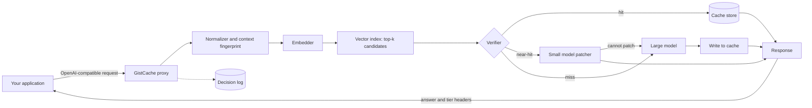

# GistCache

**A semantic caching proxy for LLM APIs that reuses near-duplicate queries instead of throwing them away.**

GistCache sits between your application and an LLM provider. It answers repeated questions from cache, adapts cached answers to slightly different questions with a small model and sends everything else to the large model. A verifier decides which path each request takes and falls back to the large model whenever reuse is not safe.

> **Status:** in development. All result numbers in this README are placeholders until the full evaluation runs. See [Results](#results).

---

## Table of contents

1. [The problem](#the-problem)
2. [How GistCache works](#how-gistcache-works)
3. [Architecture](#architecture)
4. [Request lifecycle](#request-lifecycle)
5. [The verifier](#the-verifier)
6. [The near-hit tier](#the-near-hit-tier)
7. [Cache store](#cache-store)
8. [Multi-turn conversations](#multi-turn-conversations)
9. [Invalidation and scoping](#invalidation-and-scoping)
10. [Quick start](#quick-start)
11. [Configuration](#configuration)
12. [API compatibility](#api-compatibility)
13. [Explainability and logging](#explainability-and-logging)
14. [Evaluation methodology](#evaluation-methodology)
15. [Results](#results)
16. [Cost of running the evaluation](#cost-of-running-the-evaluation)
17. [Project structure](#project-structure)
18. [Testing](#testing)
19. [Design decisions](#design-decisions)
20. [Limitations](#limitations)
21. [Roadmap](#roadmap)
22. [License](#license)

---

## The problem

Applications built on LLMs pay for the same questions again and again in slightly different words. "How do I reset my password" and "forgot my password, help" trigger two full model calls even though one answer serves both.

Semantic caches address this by embedding each query and returning a cached answer when a new query is similar enough. Most of them use a single cosine similarity threshold. That design has two flaws.

**1. Wrong answers on lookalike queries.** Embedding models place these pairs very close together even though they mean different things:

| Query A | Query B | What changed |
|---|---|---|
| cancel my order | don't cancel my order | negation |
| flights to Toronto | flights from Toronto | direction |
| sort a list in Python 2 | sort a list in Python 3 | version |
| weather in Toronto | weather in Waterloo | entity |

A loose threshold returns wrong answers for these. A strict threshold rejects them but also rejects most true paraphrases, so the hit rate collapses.

**2. Near-misses are thrown away.** "Sort a list in Python" and "sort a list in Python in descending order" count as a miss. The application pays full price even though almost all of the answer already exists.

## How GistCache works

GistCache sorts every request into one of three tiers.

| Tier | When | What happens | Relative cost |
|---|---|---|---|
| **Hit** | The new query means the same thing as a cached query | Return the cached answer | Near zero |
| **Near-hit** | The queries differ only in a way that is safe to adapt (format, order, verbosity, a narrowing constraint) | A small model adapts the cached answer to the new query | Small model call |
| **Miss** | No close match, a critical difference, new facts required or low confidence | Call the large model and cache the result | Large model call |

The key principle: **reuse only when it is safe.** The verifier and the patcher can both reject a near-hit and send the request to the large model. GistCache never forces a similar query into adaptation.

## Architecture



| Component | Default | Role |
|---|---|---|
| Proxy | FastAPI | Exposes an OpenAI-compatible `/v1/chat/completions` endpoint |
| Embedder | `all-MiniLM-L6-v2` (local) | Turns queries into vectors |
| Vector index | FAISS (in memory, persisted to disk) | Finds the top-k most similar cached queries |
| Verifier | Rule checks plus a local cross-encoder | Classifies each candidate as hit, near-hit or miss |
| Patcher | Configurable small model | Adapts a cached answer to the new query or refuses |
| Large model | Configurable large model | Answers misses and fallbacks |
| Store | SQLite | Holds entries, metadata and the decision log |

The embedder and cross-encoder run locally, so they add latency but no API cost.

## Request lifecycle

1. **Receive.** The application sends a normal chat completion request to GistCache.
2. **Bypass check.** Requests with tool definitions, a high temperature, an `X-GistCache-Bypass: true` header or a disabled scope go straight to the large model.
3. **Normalize.** Lowercase, collapse whitespace and strip boilerplate. The original text is kept for the verifier.
4. **Fingerprint context.** For multi-turn requests, build a context key from recent turns (see [Multi-turn conversations](#multi-turn-conversations)).
5. **Retrieve.** Embed the query and fetch the top-k candidates (default k = 5) within the same scope and context key.
6. **Verify.** Run rule checks and the cross-encoder on each candidate. Pick the best candidate and a tier.
7. **Serve.**
   - Hit: return the cached answer.
   - Near-hit: call the patcher. If it returns `CANNOT_PATCH` or fails validation, fall back to the large model.
   - Miss: call the large model.
8. **Store.** Cache every large model answer. Patched answers are not cached by default so errors cannot compound.
9. **Log.** Record the tier, the reason, the candidate used, scores, latency and cost.

## The verifier

The verifier is the core of GistCache. It answers one question: **how do these two queries differ, and is that difference safe to reuse across?**

### Stage 1: difference extraction (rules)

Fast deterministic checks on the original text of both queries.

| Check | Example | Classification |
|---|---|---|
| Negation | cancel vs don't cancel | Critical |
| Direction | to Toronto vs from Toronto | Critical |
| Entity swap | Toronto vs Waterloo | Critical (needs new facts) |
| Number, date or quantity change | 3 items vs 5 items | Critical |
| Language or version change | Python 2 vs Python 3, Java vs Rust | Critical |
| Time-sensitive terms | latest, today, current, price | Critical (never reused) |
| Output format | as a list vs as a table, return JSON | Patchable |
| Order or sort direction | ascending vs descending | Patchable |
| Verbosity or tone | briefly, explain like I'm five | Patchable |
| Narrowing constraint | add comments, use type hints | Patchable |

Entities are extracted with a lightweight NER model. Numbers, negations, directional words and time-sensitive terms use curated patterns.

### Stage 2: semantic scoring (cross-encoder)

A cross-encoder reads both queries together and scores how closely they match. It is much more accurate than cosine similarity on lookalike pairs because it compares the queries word by word instead of comparing two compressed vectors.

### Stage 3: decision policy

```
if any critical difference:                          -> MISS
elif no differences and score >= hit_threshold:      -> HIT
elif only patchable differences and score >= near_threshold:
                                                     -> NEAR-HIT
else:                                                -> MISS
```

Every decision carries a reason string such as `miss: negation mismatch` or `near_hit: sort direction`. Thresholds are tuned on a held-out split of the evaluation data, never on the test split.

## The near-hit tier

The patcher is a small model with a strict job: adapt a cached answer to a new query **without inventing new facts.**

### Patcher input

- The original cached query
- The cached answer
- The new query
- The list of differences the verifier found

### Patcher rules

1. Preserve all information in the cached answer that is still valid for the new query.
2. Change only what the listed differences require.
3. Do not add facts that are not in the cached answer.
4. If the new query needs information the cached answer does not contain, reply only with `CANNOT_PATCH`.

### Output validation

A patched answer is rejected and sent to the large model when:
- The patcher returns `CANNOT_PATCH`
- The output is empty or far shorter than the cached answer without a reason (such as a "briefly" request)
- The output is longer than a configured ratio of the cached answer, which suggests new content was generated

Patching is only worth it if it is actually cheaper. The evaluation counts the full cost of the patch call plus every fallback, not just the successful patches.

## Cache store

SQLite holds the entries. FAISS holds the vectors and maps back to entry IDs.

```sql
CREATE TABLE entries (
    id            TEXT PRIMARY KEY,
    scope         TEXT NOT NULL,      -- tenant or app namespace
    context_key   TEXT,               -- multi-turn fingerprint, NULL for single-turn
    query         TEXT NOT NULL,      -- original query
    query_norm    TEXT NOT NULL,      -- normalized query
    answer        TEXT NOT NULL,
    model         TEXT NOT NULL,      -- model that produced the answer
    created_at    INTEGER NOT NULL,
    expires_at    INTEGER,            -- NULL means no TTL
    hit_count     INTEGER DEFAULT 0,
    last_hit_at   INTEGER
);

CREATE TABLE decisions (
    id            TEXT PRIMARY KEY,
    request_at    INTEGER NOT NULL,
    scope         TEXT NOT NULL,
    query         TEXT NOT NULL,
    tier          TEXT NOT NULL,      -- hit | near_hit | miss | bypass
    reason        TEXT NOT NULL,
    candidate_id  TEXT,
    cosine        REAL,
    cross_score   REAL,
    differences   TEXT,               -- JSON list
    fell_back     INTEGER DEFAULT 0,
    latency_ms    REAL NOT NULL,
    cost_usd      REAL NOT NULL
);
```

Eviction is least recently used once the store passes `max_entries`.

## Multi-turn conversations

"What about the second one?" means nothing without the conversation before it. Matching it against the cache on its own text would return a random answer.

GistCache handles this in two ways:
- **Context key.** For multi-turn requests, the last N turns are summarized into a short canonical string and hashed. Candidates must share the same context key.
- **Unresolved references.** Queries that depend on earlier turns ("it", "that", "the second one") with no matching context key are always a miss.

Single-turn requests have no context key and match only other single-turn entries.

## Invalidation and scoping

- **TTL.** Each entry can expire. The default is no TTL. Time-sensitive queries are never cached at all.
- **Scope.** Every entry belongs to a scope (an app, tenant or user ID passed in a header). Lookups never cross scopes, so one user's cached answer can never reach another user.
- **Model changes.** Entries record which model produced them. Changing the large model in config can invalidate older entries.
- **Manual purge.** `gistcache purge --scope <name>` or `--older-than 7d`.

## Quick start

### 1. Install

```bash
git clone https://github.com/jaiteshgill/gistcache.git
cd gistcache
python -m venv .venv && source .venv/bin/activate
pip install -e .
```

### 2. Configure

```bash
cp config.example.yaml config.yaml
export OPENAI_API_KEY=sk-...      # or ANTHROPIC_API_KEY, or use Ollama with no key
```

### 3. Run the proxy

```bash
gistcache serve --config config.yaml --port 8100
```

### 4. Point your app at it

Only the base URL changes.

```python
from openai import OpenAI

client = OpenAI(base_url="http://localhost:8100/v1", api_key="unused-or-your-key")

resp = client.chat.completions.create(
    model="gistcache",
    messages=[{"role": "user", "content": "How do I sort a list in Python?"}],
)
print(resp.choices[0].message.content)
```

Send a second request with "How do I sort a list in Python in descending order?" and check the `X-GistCache-Tier` response header. It should read `near_hit`.

### Free local setup with Ollama

```bash
ollama pull llama3.1:8b
ollama pull qwen2.5:3b
gistcache serve --config configs/ollama.yaml
```

## Configuration

```yaml
providers:
  large:
    kind: openai            # openai | anthropic | ollama | openai_compatible
    model: your-large-model
    api_key_env: OPENAI_API_KEY
  small:
    kind: openai
    model: your-small-model
    api_key_env: OPENAI_API_KEY

embedder:
  model: sentence-transformers/all-MiniLM-L6-v2
  device: cpu

verifier:
  cross_encoder: cross-encoder/quora-distilroberta-base
  hit_threshold: 0.90       # tuned on the dev split
  near_threshold: 0.70
  top_k: 5
  rules:
    negation: true
    direction: true
    entities: true
    numbers: true
    versions: true
    time_sensitive: true

patcher:
  enabled: true
  max_length_ratio: 1.5
  cache_patched_answers: false

cache:
  path: ./data/gistcache.db
  index_path: ./data/index.faiss
  max_entries: 100000
  default_ttl_seconds: null

bypass:
  max_temperature: 0.7
  with_tools: true

multi_turn:
  context_turns: 4

pricing:                     # USD per 1M tokens, used for cost accounting
  large: { input: 0.0, output: 0.0 }
  small: { input: 0.0, output: 0.0 }
```

Fill in `pricing` with current rates from your provider so the cost numbers are accurate.

## API compatibility

| Feature | Supported |
|---|---|
| `POST /v1/chat/completions` | Yes |
| Streaming (`stream: true`) | Yes. Hits and near-hits are streamed from the final text. |
| Tool and function calling | Passed through to the large model, never cached |
| `GET /v1/models` | Yes |
| Embeddings and other endpoints | Not proxied in v1 |

### Response headers

| Header | Example |
|---|---|
| `X-GistCache-Tier` | `hit`, `near_hit`, `miss`, `bypass` |
| `X-GistCache-Reason` | `near_hit: sort direction` |
| `X-GistCache-Source` | ID of the cached entry used |
| `X-GistCache-Fallback` | `true` if a near-hit fell back to the large model |

### Request headers

| Header | Effect |
|---|---|
| `X-GistCache-Scope` | Namespace for this request |
| `X-GistCache-Bypass` | `true` skips the cache entirely |

## Explainability and logging

Every decision is logged with its reason, so you can see exactly why a request was served the way it was.

```bash
gistcache log --last 5
```

```
TIME      TIER      REASON                       COS   XENC  MS    COST
03:12:01  hit       paraphrase                   0.94  0.97  18    $0.0000
03:12:09  near_hit  sort direction               0.91  0.83  410   $0.0004
03:12:15  miss      negation mismatch            0.93  0.21  1840  $0.0061
03:12:22  miss      entity: Toronto -> Waterloo  0.95  0.66  1720  $0.0058
03:12:30  miss      near_hit fallback: CANNOT_PATCH 0.88 0.74 2210 $0.0065
```

`gistcache stats` summarizes tier counts, cost saved and latency percentiles over any time window.

## Evaluation methodology

The evaluation answers three questions:
1. Does the verifier tell equivalent queries apart from lookalikes?
2. Are cached and patched answers actually correct for the new query?
3. Is the system cheaper and faster end to end, after counting every overhead?

### Datasets

| Dataset | Used for |
|---|---|
| **Quora Question Pairs** | Verifier accuracy only. It has labelled duplicate pairs, which tests duplicate detection. It cannot tell us whether reused answers are correct. |
| **LMSYS-Chat-1M** | Realistic prompts used as seeds for the main evaluation. Access requires accepting its license on Hugging Face. |
| **Hard test set** | Hand-written and generated pairs targeting known failure cases (below). |

### Building the main query stream

1. **Select seeds.** Sample about 300 single-turn English prompts from LMSYS-Chat-1M. Drop prompts flagged by the dataset's moderation fields, prompts with personal data, very short or very long prompts and near-duplicates of each other.
2. **Generate variants.** For each seed, generate labelled variants:
   - **Paraphrase:** same meaning, different wording. Expected tier: hit.
   - **Patchable change:** format, order, verbosity or a narrowing constraint. Expected tier: near-hit.
   - **Critical change:** negation, entity, number, version or direction. Expected tier: miss.
3. **Spot check.** Manually review a sample of variants and discard mislabelled ones. Generated variants are a known limitation (see [Limitations](#limitations)).
4. **Build the stream.** Each seed appears before its variants so the cache is warm. Order is shuffled across seeds. A second cold-start ordering is also reported.
5. **Reference answers.** Get a fresh large model answer for every query in the stream. These are the ground truth for quality.

### Hard test set categories

| Category | Example pair |
|---|---|
| Negation | "should I cancel" / "should I not cancel" |
| Changed numbers | "split into 3 groups" / "split into 5 groups" |
| Programming language | "reverse a string in Python" / "reverse a string in Go" |
| Version | "Pydantic v1 validators" / "Pydantic v2 validators" |
| Direction | "convert CAD to USD" / "convert USD to CAD" |
| Output format | "list the steps" / "list the steps as a table" |
| Sort order | "sort ascending" / "sort descending" |
| Added constraint | "write a function" / "write a function with type hints" |
| Time-sensitive | "latest Python version" / "latest Python version" (must never hit) |

### Systems compared

All three run on the identical query stream.

| System | Description |
|---|---|
| **No cache** | Every request goes to the large model |
| **Threshold cache** | Standard semantic cache: cosine similarity above a tuned threshold returns the cached answer |
| **GistCache** | Three tiers with verifier and fallback |

The threshold baseline gets its threshold tuned on the same dev split as GistCache so the comparison is fair.

### Metrics

| Metric | Definition |
|---|---|
| Large model avoidance | Share of requests served without calling the large model |
| Tier distribution | Share of hits, near-hits, misses and fallbacks |
| Quality pass rate | Share of answers the judge rates as passing against the reference, reported per tier |
| False-hit rate | Share of hits and near-hits rated as failing |
| Total cost | Every API call, including patches and fallbacks, priced from config |
| Cost per 1,000 requests | Total cost normalized |
| Latency | p50 and p95, overall and per tier, including embedding and verification time |
| Verifier accuracy | Precision, recall, F1 and ROC-AUC on Quora pairs and on each hard-set category |

### Judging answer quality

- **Judge model.** A strong model that is not the patcher model, so the patcher does not grade its own work.
- **Rubric.** The judge sees the query, the reference answer and the candidate answer. It scores 1 to 5 on correctness and on whether the answer meets every requirement in the query. A score of 4 or more passes.
- **Fixed prompt.** The rubric prompt is versioned in `eval/prompts/judge.md` and never changes between runs.
- **Human check.** 50 cases stratified by tier are reviewed by hand. Agreement between the judge and the human labels is reported as Cohen's kappa.
- **Uncertainty.** Every rate is reported with a 95% bootstrap confidence interval from 1,000 resamples.

### Running the evaluation

```bash
gistcache eval verifier --dataset qqp                 # verifier accuracy on Quora pairs
gistcache eval seeds --source lmsys --n 300           # sample and filter seeds
gistcache eval variants                               # generate labelled variants
gistcache eval references                             # reference answers from the large model
gistcache eval run --system no_cache
gistcache eval run --system threshold
gistcache eval run --system gistcache
gistcache eval judge                                  # judge every candidate answer
gistcache eval report                                 # tables, plots and confidence intervals
```

Use `--n 50` while developing to keep costs low.

## Results

> **Placeholders.** These tables fill in automatically from `gistcache eval report`. No number below is real yet.

### End to end

| System | Large model avoided | Quality pass rate | False-hit rate | Cost / 1k req | p50 latency | p95 latency |
|---|---|---|---|---|---|---|
| No cache | 0% | TBD | n/a | TBD | TBD | TBD |
| Threshold cache | TBD | TBD | TBD | TBD | TBD | TBD |
| **GistCache** | TBD | TBD | TBD | TBD | TBD | TBD |

### Per tier (GistCache)

| Tier | Share of requests | Quality pass rate | Mean latency | Mean cost |
|---|---|---|---|---|
| Hit | TBD | TBD | TBD | TBD |
| Near-hit (served) | TBD | TBD | TBD | TBD |
| Near-hit (fell back) | TBD | TBD | TBD | TBD |
| Miss | TBD | TBD | TBD | TBD |

### Verifier on the hard test set

| Category | Threshold cache correct | GistCache correct |
|---|---|---|
| Negation | TBD | TBD |
| Changed numbers | TBD | TBD |
| Programming language | TBD | TBD |
| Direction | TBD | TBD |
| Output format | TBD | TBD |
| Sort order | TBD | TBD |
| Time-sensitive | TBD | TBD |

## Cost of running the evaluation

A full run (about 300 seeds and 1,200 queries) needs reference answers, judge calls and patch calls. With a paid provider this costs roughly a few dollars to low tens of dollars depending on current pricing and model choice. Ways to reduce it:

- Develop with `--n 50`.
- Use Ollama or a free API tier during development.
- Run the full evaluation once at the end with your final models.

## Project structure

```
gistcache/
├── gistcache/
│   ├── server.py            # FastAPI proxy and OpenAI-compatible routes
│   ├── pipeline.py          # request lifecycle and tier routing
│   ├── normalize.py         # text normalization
│   ├── context.py           # multi-turn fingerprinting
│   ├── embed.py             # embedder wrapper
│   ├── index.py             # FAISS index
│   ├── store.py             # SQLite entries and decision log
│   ├── verifier/
│   │   ├── rules.py         # negation, numbers, entities, direction, versions, time
│   │   ├── cross.py         # cross-encoder scoring
│   │   └── policy.py        # tier decision and reasons
│   ├── patcher.py           # near-hit adaptation and validation
│   ├── providers/
│   │   ├── openai.py
│   │   ├── anthropic.py
│   │   └── ollama.py
│   ├── cost.py              # token and cost accounting
│   └── cli.py               # serve, log, stats, purge, eval
├── eval/
│   ├── seeds.py
│   ├── variants.py
│   ├── references.py
│   ├── run.py
│   ├── judge.py
│   ├── report.py
│   ├── hard_set.jsonl
│   └── prompts/
│       ├── variants.md
│       ├── patcher.md
│       └── judge.md
├── configs/
│   ├── openai.yaml
│   ├── anthropic.yaml
│   └── ollama.yaml
├── tests/
├── config.example.yaml
├── pyproject.toml
└── README.md
```

## Testing

```bash
pytest
```

- **Unit tests** cover every rule check, the decision policy, patch validation, cost accounting and store operations.
- **Integration tests** run the full proxy against a mock provider and assert the correct tier and headers for each hard-set category.
- **Regression tests** pin the verifier's decisions on the hard set so a threshold change cannot silently break them.

## Design decisions

**Why a cross-encoder instead of a better threshold?**
Cosine similarity compares two compressed vectors, so small but critical words like "not" barely move it. A cross-encoder reads both queries together and catches these differences. It is slower, so it only runs on the top-k candidates.

**Why rules on top of the cross-encoder?**
Rules are cheap, predictable and explainable. They catch the failure types that matter most (negation, numbers, entities) with certainty and give every decision a readable reason.

**Why can the patcher refuse?**
Forcing every similar query through adaptation produces confident wrong answers. Letting the patcher return `CANNOT_PATCH` and falling back to the large model keeps quality high. The evaluation counts the cost of every fallback so the savings stay honest.

**Why not cache patched answers?**
A patched answer was produced from another cached answer. Caching it would let small errors stack across generations. Only large model answers become cache entries by default.

**Why never cache time-sensitive queries?**
"What is the latest version" has a different correct answer next month. No similarity check can know that.

## Limitations

- **Generated variants.** Most variants in the main stream are generated by a model, so they may not match the distribution of real user rephrasing. The hard set and the manual spot check reduce this but do not remove it.
- **Replayed workload.** Cost savings come from a replayed query stream, not production traffic. Real repetition rates vary widely between applications.
- **Judge reliability.** LLM judges make mistakes. The human-reviewed sample and kappa score show how far to trust them.
- **English only.** Rules and models are tuned for English.
- **Rule coverage.** Rules catch known difference types. New kinds of critical differences can still slip through to the cross-encoder.
- **Single node.** FAISS and SQLite run on one machine. A shared deployment would need a networked vector store.

## Roadmap

- [ ] Adaptive thresholds learned per query cluster
- [ ] Feedback loop: user thumbs-down evicts an entry and adjusts thresholds
- [ ] Redis and pgvector backends for multi-node deployments
- [ ] Prometheus metrics endpoint and a small dashboard
- [ ] Multilingual rules and models

## License

MIT
