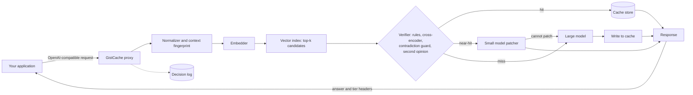

# GistCache

**A caching proxy for LLM APIs that reuses answers to repeated questions, and refuses to reuse them when the question has actually changed.**

Applications built on LLMs pay for the same question again and again in different words. GistCache sits between the application and the model provider: it answers repeats from cache, has a small model adapt a cached answer when only the format or length changed, and sends everything else to the large model. A verifier checks every candidate, so "cancel my order" never gets the answer cached for "don't cancel my order".

## Results

596 queries built from real user prompts, against a standard semantic cache that reuses an answer whenever cosine similarity passes a threshold:

| System | Wrong reuses per 100 requests | Large model avoided | Reused answers judged acceptable | Cost per 1k requests | p50 latency |
|---|---|---|---|---|---|
| No cache | 0 | 0% | n/a | $2.86 | 3.19 s |
| Threshold cache (cosine >= 0.80) | 38.4 (229 of 596) | 61% (366 of 596) | 36% (131 of 360 judged) | $1.13 | 0.01 s |
| Threshold cache (cosine >= 0.90) | 26.0 (155 of 596) | 41% (247 of 596) | 36% (87 of 242 judged) | $1.70 | 2.69 s |
| **GistCache** | **1.8 (11 of 596)** | **22% (130 of 596)** | **91% (117 of 128 judged)** | **$2.34** | **3.76 s** |

Setup: 149 real LMSYS-Chat-1M prompts, each with a paraphrase, a patchable change and a critical change (596 queries), on one stream with identical large-model answers for every system. Every reused answer was judged against a large-model reference; answers with no judge verdict (6, 5 and 2) are left out of the acceptable rate.

- **14 to 21 times fewer wrong answers**, but it reused less and cut cost by only 18%: conservative rules let it reuse 129 of the 298 paraphrases and patchable changes (43%).
- **Median latency is worse than no cache** (3.76 s against 3.19 s): hits take 0.5 s, but every miss also pays for the verifier and a volatility check.
- Of the 11 rejected reuses, 2 were genuine wrong-question reuses; most others were judge disagreements on subjective questions. All 11 count.
- One run, a judge from the same model family as the patcher, no confidence intervals.

Full tables, per-tier numbers, methodology and earlier pilots: [docs/EVALUATION.md](docs/EVALUATION.md).

## Example

Four requests in a row. The first is new, so the large model answers it and it is cached; the next three are compared with it:

| Request | `X-GistCache-Tier` | `X-GistCache-Reason` |
|---|---|---|
| How do I sort a list in Python? | `miss` | `miss: no candidates` |
| What's the way to sort a list in Python? | `hit` | `hit: paraphrase` |
| How do I sort a list in Python in descending order? | `near_hit` | `near_hit: sort order` |
| How do I sort a list in JavaScript? | `miss` | `miss: ['python'] -> ['javascript']` |

The same requests in the decision log (`gistcache log --last 4`):

```
TIME      TIER      REASON                                   COS   XENC      MS COST
18:42:13  miss      miss: ['python'] -> ['javascript']       0.67  0.00      14 $0.0000
18:42:13  near_hit  near_hit: sort order                     0.89  0.79      14 $0.0000
18:42:13  hit       hit: paraphrase                          0.98  0.98     387 $0.0000
18:42:12  miss      miss: no candidates                      -     0.00      98 $0.0000
```

Real output from the proxy and its local verifier models, with mock LLM providers in place of a paid API (hence near-zero latency and cost). With a running proxy:

```bash
curl -si localhost:8100/v1/chat/completions -H 'Content-Type: application/json' \
  -d '{"model":"gistcache","messages":[{"role":"user","content":"How do I sort a list in Python in descending order?"}]}' \
  | grep -i x-gistcache
```

## How it works

Every request lands in one of three tiers:

| Tier | When | What happens | Relative cost |
|---|---|---|---|
| **Hit** | The new query means the same thing as a cached query | Return the cached answer | Near zero |
| **Near-hit** | The queries differ only in a way that is safe to adapt (format, order, verbosity, a narrowing constraint) | A small model adapts the cached answer to the new query | Small model call |
| **Miss** | No close match, a critical difference, new facts required or low confidence | Call the large model and cache the result | Large model call |

The key principle: **reuse only when it is safe.** The verifier and the patcher can both reject a near-hit and send the request to the large model. GistCache never forces a similar query into adaptation.



**The verifier** decides, for each of the top-k similar cached queries, how the two queries differ and whether that difference is safe to reuse across. First, fast rules find differences in the original text: negation, direction, numbers, entities, programming language or version and time-sensitive terms are *critical*; output format, sort order, verbosity and narrowing constraints are *patchable*. Second, a local cross-encoder reads both queries together and scores whether they are the same question; it catches small but decisive words that barely move cosine similarity. Third, a policy combines them: any critical difference is a miss, no difference plus a high cross-encoder score is a hit, and only patchable differences plus a high cosine similarity is a near-hit. Every decision carries a reason string. On top of that, an NLI model vetoes pairs that contradict each other, a small model gives a second opinion on borderline pairs, and answers that go stale are never cached. Details: [docs/VERIFIER.md](docs/VERIFIER.md).

**The patcher** handles near-hits. A small model gets the cached query, the cached answer, the new query and the differences, and may only restructure, reorder, condense or narrow what is already there. It may not add facts, steps, numbers or code. If a correct answer needs content the cache lacks, it replies `CANNOT_PATCH` and the request goes to the large model; outputs that are empty, far too long or far too short are rejected the same way. Patched answers are not cached, so errors cannot compound. Details: [docs/ARCHITECTURE.md](docs/ARCHITECTURE.md).

## Quick start

**1. Install**

```bash
git clone https://github.com/jaiteshgill/GistCache.git
cd GistCache
python -m venv .venv && source .venv/bin/activate
pip install -e ".[ml]"      # the [ml] extra adds the local embedder, cross-encoder and NLI guard (PyTorch)
```

Without `[ml]` the proxy still starts, but falls back to a toy hash embedder and plain cosine similarity. That fallback is for tests and offline development, not for real use.

**2. Configure**

```bash
cp config.example.yaml config.yaml   # or start from configs/anthropic.yaml or configs/ollama.yaml
export OPENAI_API_KEY=sk-...         # or ANTHROPIC_API_KEY, or use Ollama with no key
# Anthropic keys that are not tied to a workspace also need: export ANTHROPIC_WORKSPACE_ID=<id>
```

**3. Run the proxy**

```bash
gistcache serve --config config.yaml --port 8100   # --config may also come first
```

**4. Point your app at it.** Only the base URL changes.

```python
from openai import OpenAI

client = OpenAI(base_url="http://localhost:8100/v1", api_key="unused-or-your-key")

resp = client.chat.completions.create(
    model="gistcache",
    messages=[{"role": "user", "content": "How do I sort a list in Python?"}],
)
print(resp.choices[0].message.content)
```

Then ask "How do I sort a list in Python in descending order?" and check the `X-GistCache-Tier` response header: it should read `near_hit`.

**Free local setup with Ollama**

```bash
ollama pull llama3.1:8b
ollama pull qwen2.5:3b
gistcache serve --config configs/ollama.yaml
```

## Features

- **OpenAI-compatible API.** `POST /v1/chat/completions` (including streaming) and `GET /v1/models`; requests with tools or a high temperature pass straight through to the large model. Works with OpenAI, Anthropic, Ollama and any OpenAI-compatible server.
- **Multi-turn safe.** Follow-up questions are matched only within the same recent conversation context, and unresolved references ("what about the second one?") are never served from cache.
- **Scoping and invalidation.** An `X-GistCache-Scope` header isolates tenants or users, entries can expire, and `gistcache purge` clears by scope or age.
- **Explainable.** Every response carries `X-GistCache-Tier`, `-Reason`, `-Source` and `-Fallback` headers, and every decision is logged with its scores, latency and cost (`gistcache log`, `gistcache stats`).

Options and headers: [docs/CONFIGURATION.md](docs/CONFIGURATION.md). Lifecycle, storage and multi-turn: [docs/ARCHITECTURE.md](docs/ARCHITECTURE.md).

## Evaluation

The evaluation asks three questions: does the verifier tell equivalent queries apart from lookalikes, are reused answers actually correct for the new query, and is the system cheaper and faster once every overhead is counted?

**Data.** The main evaluation uses real single-turn prompts from LMSYS-Chat-1M, a public log of user conversations with chatbots. Prompts are filtered for language, length, personal data, moderation flags and machine-generated templates, then 150 are sampled; 149 got usable variants, giving 596 queries. A model writes three labelled variants of each: a paraphrase (should hit), a patchable change such as "as a table" (should be a near-hit) and a critical change such as a negation or a swapped entity (should miss). Before that, 245 hand-written labelled pairs, including a set never tuned on, were used to develop the verifier.

**Systems.** GistCache and a plain threshold cache at cosine 0.80 and 0.90 run on exactly the same query stream. Each distinct question goes to the large model once and every system gets that same answer.

**Metrics and judging.** Large-model avoidance, cost per 1,000 requests and p50/p95 latency are measured directly. Every reused answer from every system is judged by an LLM against a fresh large-model reference, which gives the acceptable-reuse rate and the wrong-reuse count. Every paid script has a hard spend cap; the real-prompt run cost $1.83.

Methodology, commands, full results and earlier pilots: [docs/EVALUATION.md](docs/EVALUATION.md).

## Design decisions

- **A cross-encoder, not a better threshold.** Cosine similarity compares two compressed vectors, so critical words like "not" barely move it. A cross-encoder reads both queries together; being slower, it runs only on the top-k candidates.
- **Rules on top of the model.** Rules are cheap, predictable and explainable. They catch the failure types that matter most (negation, numbers, entities) and give every decision a readable reason.
- **A contradiction guard that can only veto.** As an equivalence check, NLI rejected true paraphrases; as a contradiction detector it cleanly separated opposites ("attract / repel") from paraphrases. Using it only as a veto keeps its strength and avoids its weakness.
- **The patcher may refuse.** Forcing every similar query through adaptation produces confident wrong answers. `CANNOT_PATCH` falls back to the large model, and the evaluation counts the cost of every fallback so savings stay honest.
- **Patched answers are not cached.** A patched answer was made from another cached answer; caching it would let small errors stack across generations.

All design decisions: [docs/ARCHITECTURE.md](docs/ARCHITECTURE.md#design-decisions).

## Limitations and roadmap

- **Slower on misses.** Every miss pays for the local verifier models and a synchronous volatility check, so the median request was slower than with no cache.
- **Conservative on real text.** The number and entity rules blocked many safe reuses of real-user paraphrases, which is why savings were 18%.
- **Small samples.** 245 hand-written pairs, 96-query pilots and one 596-query run, with model-generated variants and a judge from the patcher's model family.
- **Rule vocabularies are finite.** Antonym, constraint and volatile-topic patterns are word lists, and there is no NER model; the model-based layers exist to cover the gaps but can be wrong too.
- **Single node, English only.** SQLite and in-process vector search run on one machine; rules and models are tuned for English.

**Done:** real-prompt evaluation against a threshold baseline, judging of every reused answer, the safety layers, regression pins and CI. **Remaining:** an independent judge, a human-checked sample and confidence intervals; the volatility check off the request path; fewer number- and entity-rule false positives; edit-based near-hits; NER; a vector index. Full list: [docs/ARCHITECTURE.md](docs/ARCHITECTURE.md#limitations).

## Development

```bash
pytest                       # about 400 fast tests; GISTCACHE_SLOW=1 pytest adds the full-model regression pins
```

Tests cover every rule, the policy, the pipeline and HTTP proxy against mock providers, retries, the CLI, the eval harness and pinned decisions on all 245 labelled pairs; CI runs on Python 3.10 and 3.12. Details: [docs/ARCHITECTURE.md](docs/ARCHITECTURE.md#testing).

<details>
<summary>Project structure</summary>

```
GistCache/
├── gistcache/
│   ├── server.py            # FastAPI proxy and OpenAI-compatible routes
│   ├── pipeline.py          # request lifecycle and tier routing
│   ├── normalize.py         # text normalization
│   ├── context.py           # multi-turn fingerprinting
│   ├── embed.py             # embedder wrapper
│   ├── index.py             # exact cosine top-k
│   ├── store.py             # SQLite entries and decision log
│   ├── verifier/
│   │   ├── rules.py         # difference rules: negation, numbers, entities, direction, languages, time, format
│   │   ├── cross.py         # cross-encoder scoring
│   │   ├── guard.py         # NLI contradiction guard
│   │   ├── borderline.py    # small-model second opinion on unsure pairs
│   │   └── policy.py        # tier decision and reasons
│   ├── patcher.py           # near-hit adaptation and validation
│   ├── providers/
│   │   └── base.py          # OpenAI-compatible (also Ollama) and Anthropic, with retries
│   ├── cost.py              # token and cost accounting
│   ├── config.py            # defaults and YAML loading
│   └── cli.py               # serve, log, stats, purge
├── eval/
│   ├── run.py               # verifier eval on labelled pairs vs a threshold cache
│   ├── stream.py            # end-to-end run: GistCache and threshold caches on one stream, judged (--dry-run is free)
│   ├── baseline.py          # threshold-cache baseline and the shared large-model answer memo
│   ├── seeds_build.py       # real-prompt seeds from LMSYS-Chat-1M or Dolly (output gitignored)
│   ├── seed_filter.py       # which real prompts are usable: length, English, no personal data, no duplicates
│   ├── variants.py          # labelled variant generation (cached on disk)
│   ├── judge.py             # LLM judge for reused answers
│   ├── judge_debug.py       # re-judge pilot hits and print raw judge replies
│   ├── patcher_check.py     # A/B of the patcher prompts on real and synthetic cases
│   ├── volatility.py        # validates the volatility check against a real model
│   ├── borderline.py        # lists / measures the borderline second opinion
│   ├── borderline_stress.py # is the judge too eager to say YES? (24 near-misses, 12 paraphrases)
│   ├── spend.py             # spend tracking and cap
│   ├── pin.py               # (re)generate pinned.json, the regression pins
│   ├── pinned.json          # pinned rule differences and tiers for every eval pair
│   ├── seeds.py             # 40 hand-written seed prompts
│   ├── build_hard_set.py    # -> hard_set.jsonl   (tuned on)
│   ├── build_held_out.py    # -> held_out.jsonl   (tuned on)
│   ├── build_fresh.py       # -> fresh.jsonl      (not tuned on)
│   └── results/
│       ├── eval_lmsys.md    # real-prompt evaluation report (149 seeds, 596 queries; no prompt text)
│       └── pilot.md         # latest pilot report (hand-written seeds, 96 queries)
├── docs/                    # VERIFIER, ARCHITECTURE, CONFIGURATION, EVALUATION
├── configs/
│   ├── anthropic.yaml       # Sonnet large, Haiku small, real pricing
│   └── ollama.yaml          # free local models, optional judges off
├── tests/
├── .github/workflows/test.yml
├── config.example.yaml
├── pyproject.toml
├── LICENSE
└── README.md
```

</details>

## License

MIT, see [LICENSE](LICENSE).
