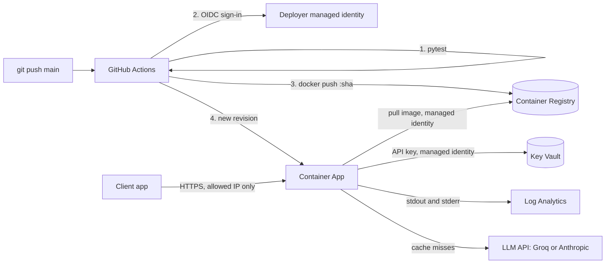

# Deployment

GistCache runs as a container on **Azure Container Apps**. Every push to `main` is tested, built into an image, pushed to Azure Container Registry and rolled out as a new revision. If the new revision never passes its health check, the pipeline rolls back to the previous image.



## What runs where

| Piece | Azure service | Why |
|---|---|---|
| Container image | Azure Container Registry, tagged with the git SHA | Every deploy maps to an exact commit, so rollback means redeploying an older tag |
| App | Azure Container Apps, 2 vCPU / 4 GiB, 1 replica | Managed containers: HTTPS, health probes and revisions without running a VM or Kubernetes cluster |
| API key | Key Vault, referenced by the app (not copied into it) | Encrypted, access-controlled by RBAC, rotatable without a redeploy, never in git, the image or Terraform state |
| Logs | Log Analytics workspace | Container output is queryable with KQL after the container is gone |
| Cache data | SQLite inside the container | Single replica on purpose: see "Trade-offs" |
| Infra | Terraform in `infra/` | Reproducible: `terraform destroy` and `apply` give the same environment |

## Security choices

- **No passwords or client secrets anywhere.** The app pulls from ACR and reads Key Vault through a user-assigned managed identity. GitHub Actions signs in through OIDC federation, and only workflows on `main` of this repo are trusted.
- **Least privilege.** The app identity has `AcrPull` and `Key Vault Secrets User`. The deployer has `AcrPush` and `Contributor` on this one resource group; in RBAC mode that does not include reading Key Vault secrets.
- **ACR admin user disabled**, so there is no shared registry password to leak.
- **Ingress restricted to one IP** (`allowed_cidr`), because the proxy spends real API credits. HTTPS is terminated by Container Apps.
- **Non-root container.**

## Health checks

Three probes, all on `GET /healthz` (which also checks the cache database):

- **Startup**: allows up to ~100 s for the models to load before anything else runs.
- **Readiness**: no traffic until it passes.
- **Liveness**: restart the container if it stops answering.

## First-time setup

Prereqs: Azure CLI (`az login`), Terraform 1.5+. No local Docker needed: the first image is built in Azure with `az acr build`.

```bash
az provider register -n Microsoft.App --wait
az provider register -n Microsoft.OperationalInsights --wait

cd infra
export TF_VAR_subscription_id=$(az account show --query id -o tsv)
export TF_VAR_allowed_cidr="$(curl -s https://checkip.amazonaws.com)/32"
terraform init

# 1. Registry and Key Vault first: the app needs an image and a secret to exist.
terraform apply -target=azurerm_container_registry.acr \
  -target=azurerm_key_vault.kv -target=azurerm_role_assignment.me_kv_officer

# 2. Store the API key (role assignments can take a minute to apply)
az keyvault secret set --vault-name $(terraform output -raw key_vault_name) \
  --name llm-api-key --value "sk-ant-..."

# 3. Build the first image inside Azure
az acr build --registry $(terraform output -raw acr_name) --image gistcache:initial ..

# 4. Everything else
terraform apply

# 5. Check it
curl -s $(terraform output -raw api_url)/healthz
```

Then in GitHub, Settings -> Secrets and variables -> Actions -> Variables:

| Variable | Value |
|---|---|
| `AZURE_CLIENT_ID` | `terraform output -raw deployer_client_id` |
| `AZURE_TENANT_ID` | `terraform output -raw tenant_id` |
| `AZURE_SUBSCRIPTION_ID` | `az account show --query id -o tsv` |
| `ACR_NAME` | `terraform output -raw acr_name` |

These are identifiers, not credentials, so they are variables rather than secrets.

## Operating it

```bash
az containerapp revision list -n gistcache -g rg-gistcache -o table   # revisions and their health
az containerapp logs show -n gistcache -g rg-gistcache --follow         # live logs
az containerapp exec -n gistcache -g rg-gistcache --command "gistcache --config configs/anthropic.yaml stats"

# Manual rollback to any pushed commit
az containerapp update -n gistcache -g rg-gistcache --image <acr>.azurecr.io/gistcache:<sha>
```

Log Analytics query for errors in the last hour:

```kusto
ContainerAppConsoleLogs_CL
| where TimeGenerated > ago(1h) and Log_s has "error"
| project TimeGenerated, RevisionName_s, Log_s
```

## Run locally

```bash
echo "ANTHROPIC_API_KEY=sk-ant-..." > .env
docker compose up --build
curl localhost:8100/healthz
```

## Choosing the LLM provider

The image ships every config. The default is `configs/anthropic.yaml` (Claude Sonnet for misses, Haiku for patching and second opinions), the setup the evaluation was run on. To use Groq's free tier instead, store a Groq key as `llm-api-key` and apply with:

```bash
terraform apply -var config_path=configs/groq.yaml -var api_key_env=GROQ_API_KEY
```

Cost control: set a monthly spend limit in the Anthropic console. At demo traffic a cache miss costs about a cent.

## Cost

With `min_replicas = 1`, about US$5 a day. Set `min_replicas = 0` to scale to zero when idle: almost free, but the first request after idle waits about a minute for the models to load. `terraform destroy` removes everything.

## Trade-offs and what I'd change for production

- **The cache resets on every deploy.** SQLite lives inside the container, and Container Apps replaces the container on each revision. Acceptable for a cache, which refills itself. Mounting Azure Files would keep it, but SQLite over SMB has file-locking problems, so the real fix is the next point.
- **One replica.** Two replicas would each keep a separate cache. To scale out, move the cache to a shared store (Postgres with pgvector, or Redis) and raise `max_replicas` with an HTTP scaling rule.
- **Remote Terraform state** in an Azure Storage blob with locking, instead of a local state file.
- **Alerts** in Azure Monitor on restarts and 5xx rate.
- **Private networking**: a VNet-integrated environment with Key Vault and ACR on private endpoints.

## AWS equivalent

| Azure | AWS |
|---|---|
| Container Apps | ECS Fargate (or App Runner) |
| Container Registry | ECR |
| Key Vault | Secrets Manager / SSM Parameter Store |
| Log Analytics | CloudWatch Logs |
| Managed identity | IAM role |
| Federated identity credential | IAM OIDC provider + role trust policy |
| Resource group | No direct match; tags or a separate account |
